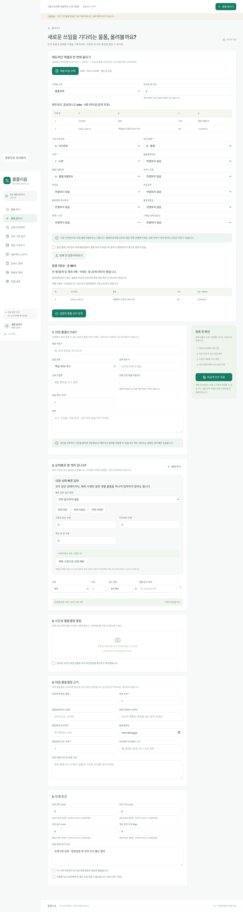
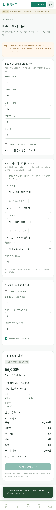
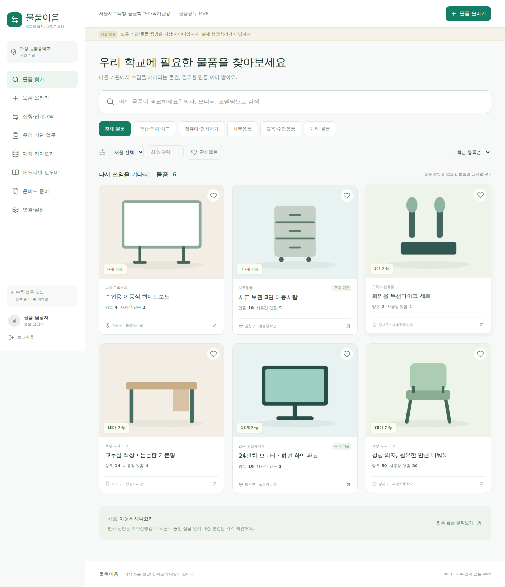
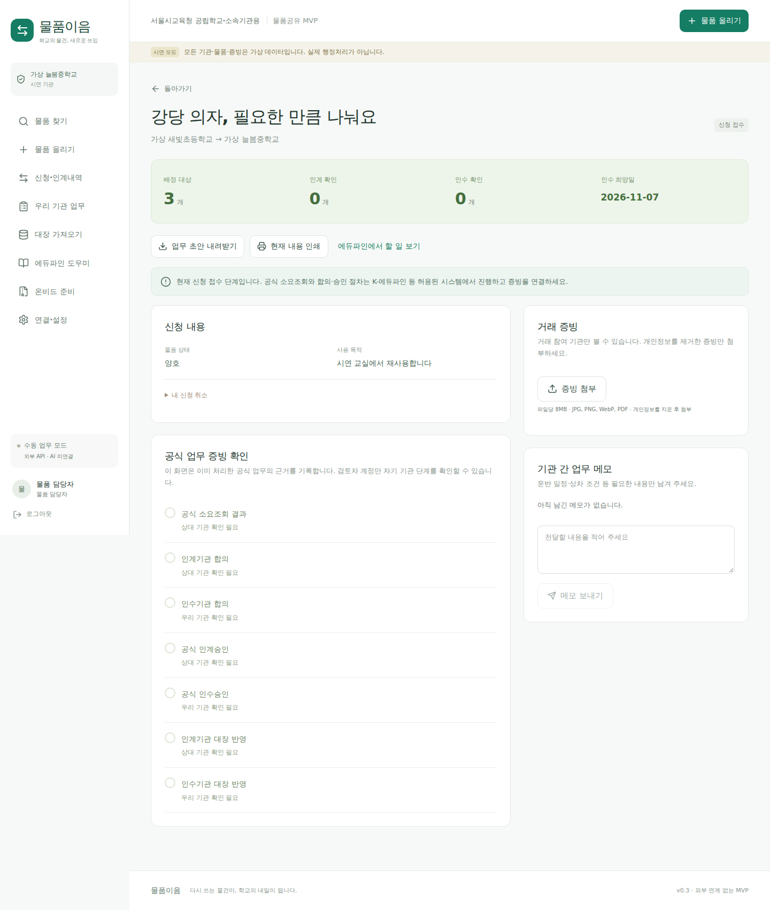

# v0.4 신규 화면 — 합성 데이터 브라우저 캡처

## 엑셀 업로드·열 연결·등록 미리보기

## 모바일 배송비 예상 계산

## 모바일 물품 올리기

배송 단가는 시연용 가정이며 실제 운송업체 견적이 아닙니다. 외부 키 없는 테스트 환경에서 촬영했으며 공급자 실접속 완료를 나타내지 않습니다.

---

# 물품이음 실행 화면

아래 이미지는 구현한 앱을 Chromium에서 실행하여 캡처한 **합성 데이터 시연 화면**입니다. 실제 기관·물품·행정문서가 아닙니다. 제품 그림은 현물사진이 아닌 예시 일러스트입니다. 실제 등록에서는 기관 담당자의 현물사진을 사용합니다.

## 데스크톱 물품 찾기

## 모바일 물품 찾기

## 신청·인계 업무

## 실행 및 후속 작업

[실행 안내](../README.md) · [검증 기록](TEST_REPORT.md) · [Codex 인계](CODEX_HANDOFF.md)

공식 API·AI와 실제 운영서버 배포는 연결하지 않았습니다. 화면의 업무 완료는 담당자가 제출한 증빙 확인 기준입니다.
